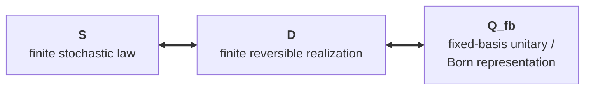

# The Incompleteness of Observation

**Author:** Alex Maybaum  
**Field:** Theoretical physics / foundations

This repository develops the **Observational Incompleteness (OI)** framework: a programme for investigating what physical laws are accessible to an observer embedded in a dynamical system, given partial access and a specified finite-capacity observation interface. Finite reversible systems provide exact representatives of finite-horizon observable laws under their stated conditions; finiteness of the total substratum is a separate model premise, not a consequence of embedded observation.

The framework is inspired by the same broad kind of self-reference constraint that appears in Gödel and Turing: an embedded system cannot, in general, obtain complete access to itself. OI studies the physical consequences of that limitation.

> **Scope note.** Throughout the project, “derived” means derived **relative to the named structural and empirical premises**. The framework is best read as a compression of physics onto a small set of commitments, not as a derivation of known physics from the bare fact of observation alone. See the book §4.7 and `SM` §8.3.

## Start here

| If you want | Start with |
| --- | --- |
| A short introduction to the framework's finite-observer results | [`papers/Introduction.md`](papers/Introduction.md) |
| The foundational finite-observer result | [`papers/Main.md`](papers/Main.md) |
| A short, self-contained phenomenology paper | [`papers/Juno.md`](papers/Juno.md) |
| The current formal-verification programme | [`verification/README.md`](verification/README.md) |
| Tracked obligations, planned work and priorities | the open [Issues](https://github.com/amaybaum/incompleteness/issues), under the rules of [`AGENTS.md`](AGENTS.md) §A.45 |
| The full book-length exposition | [`book/README.md`](book/README.md) |
| The physics papers | [`papers/`](papers/) |

## The foundational correspondence

At finite observational horizon, the framework relates three descriptions:



The representation equivalence is universal at this finite-record level. The specifically OI content is the embedded-observer structure: coupling, hidden capacity, persistence and history readback constrain what a faithful realization must contain.

`Main` develops this finite-horizon correspondence together with the hidden-memory and recurrence results. Later operational/composite refinements, Bell questions and physics-layer bridges are tracked separately rather than folded into the base theorem; their planning is tracked in the research backlog (GitHub Issues), and their status in the papers and verification records that state them.

## What is core, conditional, and conjectural

The repository deliberately separates three levels of claim.

### 1. Core mathematical and physical programme

The physics core is developed in `Main`, `SM`, `GR`, `Substratum`, `Structure`, `Methodology`, and the focused `Juno` paper. Formal and computational certificates live under [`verification/`](verification/).

### 2. Conditional bridges

Several later physics conclusions require explicitly named hypotheses or bridge statements. These are not silently promoted to consequences of OI. Important examples include:

- **H-link** — identifies the exact six-link cubic representation with a physical gauge carrier; the single-copy clause gives the $K=6$ reading.
- **H-cust** — the custodial kinetic/condensate premise used by the stabilizer route.
- **H-Bell** — the open compatibility requirement that preparation-indexed graphs (i) supply the required ontic parameter dependence, (ii) preserve operational no-signaling, and (iii) preserve the metric/Ollivier--Ricci structure strongly enough for the continuum-curvature step.
- other manuscript-specific bridge hypotheses and obligations recorded in the papers and the verification records.

### 3. Conjectural extensions

Applications outside the physics core are exploratory and carry **no evidential weight for the core framework**:

- [`papers/Complexity.md`](papers/Complexity.md) — the structural chain toward evolution and complexity;
- [`papers/Computation.md`](papers/Computation.md) — computation and complexity theory;
- [`papers/Medicine.md`](papers/Medicine.md) — medicine;
- [`papers/Bioinformatics.md`](papers/Bioinformatics.md) — computational biology;
- the consciousness discussion in the book.

Each extension should be judged on its own test-or-break conditions.

## Core papers

| Work | Role |
| --- | --- |
| [`Main`](papers/Main.md) | Finite embedded observers, hidden memory, the finite-horizon $S \iff D \iff Q_{\mathrm{fb}}$ correspondence, and falsification conditions. |
| [`SM`](papers/SM.md) | The $d=3$ simple-cubic branch, exact lattice/representation results, and the Standard-Model phenomenology with its named bridge assumptions. |
| [`GR`](papers/GR.md) | The cosmological-horizon route to the gravitational and dark-sector programme, with assumptions and open calculations stated where they enter. |
| [`Substratum`](papers/Substratum.md) | Reconstruction and substratum gauge structure; the proved converse is scoped to the local propagating lattice/gauge residue under its stated hypotheses. Bell-inclusive existence is conditional on H-Bell; its uniqueness is open. |
| [`Structure`](papers/Structure.md) | Observation/gauge hierarchies, universality classes of embedded observers, and comparison with other unification programmes. |
| [`Methodology`](papers/Methodology.md) | **Developmental draft** on the framework's foundations, methodology, and axiom structure. |
| [`Juno`](papers/Juno.md) | Focused presentation of the parameter-free solar-mixing value and its retrodictive/forward-test status. |

## A focused empirical example: JUNO

`Juno` presents

$$
\sin^2\theta_{12}=\frac13-\frac{1}{4\pi^2}=0.3080.
$$

The value was derived after JUNO's first measurement, so the existing agreement is a **retrodiction**, not a prediction made in advance. The paper treats JUNO's design-lifetime precision as the forward test. Full numerical and classification details are in the `Juno` paper and the relevant physics papers rather than being duplicated here.

## Verification

The verification suite is the authoritative place for machine-checked status. It has three main layers:

- [`verification/lean/`](verification/lean/) — dependency-free Lean 4 kernels plus concrete numerical probes;
- [`verification/lean-mathlib/`](verification/lean-mathlib/) — the Mathlib-based `OIBridge` theorem programme;
- [`verification/coverage/`](verification/coverage/) — the manuscript-to-certificate coverage ledger.

CI checks the proof layers, probes, coverage and governed receipts. Exact theorem counts and current obligations change as the programme advances, so this README intentionally does **not** hard-code those counts.

The verification architecture and flagship formal results are described in `verification/README.md`, and planning and priorities are kept in GitHub Issues, under the rules of `AGENTS.md` §A.45; both are linked under *Start here*. `verification/ROADMAP.md` is the obligation queue as it stood at `9613b21c`, kept as a historical record. To run the zero-import checks, see [`verification/lean/VERIFYING.md`](verification/lean/VERIFYING.md); the narrower zero-import formalization roadmap is [`verification/lean/ROADMAP.md`](verification/lean/ROADMAP.md).

## Repository map

```text
incompleteness/
├── papers/           Research papers and lattice-computation source
├── book/             Book-length exposition
├── verification/     Lean proofs, Mathlib bridge, probes, coverage and receipts
├── tools/            Build, audit and release-gate tooling
└── README.md
```

### Other materials in `papers/`

- [`papers/Introduction.md`](papers/Introduction.md) — short introduction for newcomers, written for readers without a background in quantum theory: the finite-horizon correspondence among stochastic laws, reversible realizations and fixed-basis quantum records; why any memory in the records must sit in the hidden state; recurrence and forecasts that cannot be chained; what the correspondence does not establish about quantum mechanics; and scoped applications to vacuum energy and black-hole information. Its proofs and their verification are in the formal papers it cites. [`papers/introduction_repro/`](papers/introduction_repro/) holds historical verification evidence: the Lean axiom reports, with the recipe that reproduces them, for the 28 baseline declarations (at `17b830bc`) listed in Appendix A of the Introduction as landed at `f5efa7a0`.
- [`papers/oi_lattice_code/`](papers/oi_lattice_code/) — lattice Monte Carlo and related numerical source.

The core papers are tabulated above; the conjectural-extension papers are listed under *3. Conjectural extensions*.

## Current research frontier

The verification programme changes faster than this README should. Planning and priorities —
which obligations are tracked and in what order — are kept in GitHub Issues, under the rules of
`AGENTS.md` §A.45. The status of a result is what its proof, Lean module, manuscript statement
and verification record establish; the coverage ledger and the Lean-to-manuscript census keep the
manuscripts aligned with the kernel.

The backlog tracks, among other areas, operational/composite refinements; the **K1–K3 / K∞ / Kₙ
pre-quantum kinematics programme**; physical-carrier identification; Standard-Model bridge
conditions; Bell-compatible completion; gravity/running obligations; and continuum emergence.
`verification/ROADMAP.md` records the queue as it stood at `9613b21c` and is not maintained.

## Book

**The Incompleteness of Observation: A Unified Framework from Quantum Mechanics to Computational Biology** develops the framework across 20 chapters with expanded exposition, appendices, glossary and bibliography.

The reader's guide is `book/README.md` (linked under *Start here*); the compiled manuscript is [`book/The-Incompleteness-of-Observation-FULL.pdf`](book/The-Incompleteness-of-Observation-FULL.pdf).

## Citation and archive

The repository is archived on Zenodo under concept DOI **10.5281/zenodo.19060318**, which resolves to the latest version. For a claim tied to a particular release, cite that release's version DOI.

> Maybaum, A. (2026). *The Observational Incompleteness Framework*. Zenodo. https://doi.org/10.5281/zenodo.19060318

## Licensing

This repository contains both code and authored research material:

| Scope | License |
| --- | --- |
| Source code — including `papers/oi_lattice_code/`, `verification/`, `tools/`, and other program source | **MIT**, per [`LICENSE`](LICENSE) |
| Manuscripts — the papers and book | **CC-BY-4.0** |

`LICENSE` is intentionally the repository's machine-detected MIT license file; the manuscript licence applies by scope to the authored research works.

## Contact

Alex Maybaum — Independent Researcher  
[LinkedIn](https://www.linkedin.com/in/amaybaum)
