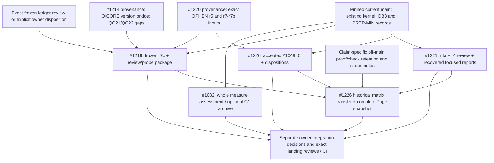

# Older accepted-evidence preservation and integration decision packet

**Writer complete; WIP pending separate non-author review and ChatGPT exact-head review. No landing, retirement or merge decision is made.** Accountable home: #1226. Guiding proposal: [#1280](https://github.com/amaybaum/incompleteness/pull/1280).

Audit cut: `main` **`c3b5f37a354bb26437e2e0165c576a347a63c153`**, inspected 2026-11-13. Repository instructions: `AGENTS.md` blob `8900fe1ff55e45a64732e6751c2601a91367dcfd`. Authority: [#1226 c.6863602829](https://github.com/amaybaum/incompleteness/pull/1226#issuecomment-6863602829) and [#1169 c.6863608722](https://github.com/amaybaum/incompleteness/issues/1169#issuecomment-6863608722). This audit is read-only paper/provenance work; all findings retain research **[R]** standing. Existing kernel theorems cited as support keep their actual hypotheses and evidence layer.

Proposed new repository path: `verification/audits/integration/older-evidence-20261113/`. This proposal neither copies accepted scientific texts into main nor changes their bytes. #1216 remains Backlog; its treatment here is provenance/integration auditing only. #1214/#1270 are source references, with no landing authority. Claude's #1268–#1276 assessment, C3, G3 unit 2(a) and REC-1 r9 remain separate.

## 1. Decision in brief

Preserve the four exact research records and their actual evidence layers. Do not equate a green historical CI run, a draft's host mergeability, a preserved hash, owner ratification or independent model acceptance with a complete integration decision or physical OI mechanism.

The strongest new recovery is **the previously missing #1221 focused r4a review**: two original reports survive locally, including final ACCEPT at the exact unchanged head. The final report's SHA-256 is exactly the `f17ccc0e…` previously cited by #1221/#1226. This closes the inspected artifact-availability gap. Neither report is currently among #1221's four files, and there are no PR review submissions or comments carrying it; durable retention remains an integration obligation.

Two other facts change the predecessor's source picture. Current main already contains the exact and 1% PREP-MIN proofs/reviews/status notes, so #1226's pending-PREP-MIN statements are historical. #1270 now contains the exact three QPHEN-r5 texts that accepted #1049 r5 correctly reported unrecovered on November 10. They remain off main. The original BRIDGE-r3 pin remains unavailable in the inspected sources.

The smallest consequential unresolved provenance defect is **#1219's frozen dispositions**: CHECK-r7c names SHA-256 `856fa01d…`, while the frozen/published ledger is `d3adc823…`. The owner freeze explicitly identifies the latter, but an independent check of those exact ledger bytes, or an explicit owner disposition of that review-identity difference, has not been recovered. The four substantive r7c specifications do match the independent check's pins.

## 2. Exact heads, overlap and CI

| PR | Exact audited head | Historical merge base; divergence from current main | Host state | Existing exact-head ordinary PR CI |
| --- | --- | --- | --- | --- |
| #1226 | `f1a8f1a55ff0da200edc6908f64f00f684911109` | `cac5d26441dd33e9348151487e4df7b547195481`; 5 ahead / 225 behind | Open, draft, unmerged; `mergeable=true`, `mergeable_state=behind` | Run [42822329052](https://github.com/amaybaum/incompleteness/actions/runs/42822329052), attempt 1: success; 26 successful jobs, 1 skip |
| #1221 | `e41cf6137be165add39c7e557e97d3dddf110239` | Same merge base; 4 ahead / 225 behind | Open, draft, unmerged; mergeable=true, behind | [42662313573](https://github.com/amaybaum/incompleteness/actions/runs/42662313573), attempt 1: success; 26 successes, 1 skip |
| #1219 | `4c7f3f86191847592de18de55b364cc8cf591bb3` | Same merge base; 1 ahead / 225 behind | Open, draft, unmerged; mergeable=true, behind | [42640786616](https://github.com/amaybaum/incompleteness/actions/runs/42640786616), attempt 1: success; 26 successes, 1 skip |
| #1082 | `29430f7b43a824c5d6f58c1233032c6d16861d79` | `1609dc440f5a12d05b750f6d894bb91d09a099a3`; 21 ahead / 998 behind | Open, draft, unmerged; mergeable=true, behind | [42407065158](https://github.com/amaybaum/incompleteness/actions/runs/42407065158), attempt 1: success; 25 successes, 1 skip |

All skips are the conditional `A42 exclusion` matrix job. The REST check-runs and attempt-1 jobs agree, with all jobs completed. Legacy combined-status endpoints return `pending` with **zero statuses**; that empty legacy channel is not a failing check and does not replace the populated check-runs channel. No workflow or job was started, retried or dispatched by this audit. It does not inventory every repository event, certify a scientific run or establish a new landing's required checks.

**Actual file overlap:** the 62 changed paths (3 + 4 + 48 + 7) are all additions relative to their source bases. None exists at the same path on pinned current main; none of their entire Git blobs occurs elsewhere in the current-main tree. The compare API returned exactly the same file sets and counts. These facts explain a clean host merge calculation; they do not establish semantic compatibility.

**Semantic overlap/conflicts:** the retained QB3 extract already supplies part of #1082 (CE-8/B4), without the entire assessment. #1226 carries stale pending-review, pending-Page-transfer and PREP-MIN planning statements. #1214 similarly says some reviews are “on main” although its whole PR is still unmerged. These historical source statements require a new accurate status wrapper if preserved, not silent rewriting. The challenged amplitude-gauge clauses remain in current `papers/Substratum.md` around 270–274; #1049 r5's narrow corrections are still proposals, not manuscript corrections implemented by this packet. Current main also changes many surrounding manuscript contexts; historical `Main:N`/`SM:N` citations must retain their source pins rather than be interpreted as today's line numbers.

## 3. Dependency graph and order

Arrows mean **support or preservation prerequisites for the stated full-scope option**, not launch permission or a new scientific implication.

The #1049 r5 paper can be considered separately from its matrix transfer record. #1082's preservation decision is independent of the QPHEN/OICORE chain. A historical **[R] snapshot with explicitly retained gaps** has a weaker support contract than landing all of its scientific assertions as established claims; the owner must choose which is intended. This audit does not grant a gap exception.

Suggested preparation order, without executing any landing:

1. Retain the recovered #1221 focused reports and the current matrix Page readback in this audit's evidence custody.
2. Prepare a standalone #1049 r5 preservation option, with its accepted blobs/receipts and explicit historical-status note. Keep matrix transfer separate.
3. Choose #1082's math-only, seven-file archive, keep-open or retirement option independently.
4. Resolve #1219's exact-ledger disposition and the OICORE version/support bridge; coordinate the necessary #1270 subset with Claude's separate assessment rather than editing that branch.
5. Only then consider an updated matrix landing/status wrapper based on the selected support. Preserve original reviewed matrix history; any newly reconciled current scientific assertions require their own writer scope and review.

## 4. #1226 — accepted r5 is distinct from the matrix transfer

The final #1049 r5 assessment/dispositions at accepted commit `2d9bb8d17d6994a9603ab84eed346e05be201d60` are byte-identical at #1226's current head. Exact primary blobs:

| File | Git blob | SHA-256 |
| --- | --- | --- |
| `ASSESS-1049.md` | `94ce80ed8778c600ca6816fa1b106aa16911b5a7` | `23cfb0ff6f0d11721e20445d01fc374568b089c7e0e821d0f8f25aef538bd7bb` |
| `DISPOSITIONS-r5.md` | `927a648f414cca23686f60458d4fa4e975a7f76a` | `1d4623e3bdf8feea52b5e93314caa984e064c08c3ff8a466c0bcf88a3243b36b` |
| `RECONCILIATION-r2.md` | `6048ced39e3fee189d12895ebf7ce6e154fcdfdd` | `ded307037eac983e703ee7e525777a756d90e96c7d86d9f9180fb7b7e91748d4` |

The first two paths are under `verification/programmes/substratum/a5-reassessment-20261110/`; the third is under `verification/programmes/oi-qm/dependency-matrix/`.

**Review receipts:** full r5 REVISE [5842223017](https://github.com/amaybaum/incompleteness/pull/1226#pullrequestreview-5842223017), focused correction check 5842261980, final cumulative ACCEPT [5842263857](https://github.com/amaybaum/incompleteness/pull/1226#pullrequestreview-5842263857) at `2d9bb8d…`. The r5 source bytes match the reviewed accepted pin. Changed-dependency matrix ACCEPT [5842538615](https://github.com/amaybaum/incompleteness/pull/1226#pullrequestreview-5842538615) is at the exact current `f1a8f1a5…` head. All are model-authored non-author agent reports relayed from the owner account, GitHub state `COMMENTED`; none is a human approval or merge permission.

**Present-day stale-source corrections belong in a wrapper:**

- Assessment header/dispositions still describe a future full r5 review; that review was subsequently completed. RECONCILIATION still says pending and Page unchanged; the later review/transfer receipts and the actual Page demonstrate otherwise.
- PREP-MIN is described as a pending definition/proof authorization. Pinned current main contains `prep-min-exact-t2-20261110/{PROOF.md,REVIEW-5843234635.md,STATUS.md}` and the corresponding `prep-min-robustness-1pct-20261110/` package. Their scoped conditional mathematical results are not physical apparatus bounds. This audit restates their **availability and standing**, without reopening approximation research.
- r5's original BRIDGE-r3 pin `a5d7aad1…78c1` remains **UNAVAILABLE** in inspected sources. The archived differently hashed r3 (`ee1c83c0…`) must not be substituted.
- r5's three historical QPHEN-r5 inputs are now recoverable on #1270 at exact SHA-256s `e231a795508769cec7645f05931b1ce04e418bbd69acd8802f794a0bec8add71`, `7f4cd21d02a0dbf7946c4d481c6140f7e3c6df053a5096b8fd589de123a7b5a5` and `a72067015789371a087517d92f71a5fcc654770d1d3f105e217eda6fcba2cc4d`. All three bytes were fetched and verified in this audit. Recovery does not place them on main or adopt their hypotheses.

**Cross-service matrix:** #1226 contains a guarded **transfer specification**, not the whole dependency matrix. The live matrix Page `page_9580d355639c81919a21ae4d8af34201` was recovered read-only: 84 blocks, update timestamp `2026-11-10T13:23:20.179160Z`. It contains the original r1 review history and the r2 exact-commit ACCEPT receipt. `MATRIX-PAGE-SNAPSHOT.json` preserves the complete returned content/identity; its Markdown projection is a newly defined reading representation, not a claim to the byte hash of a lost original Markdown file. No second Git repository holding the complete current matrix was identified. A repository landing must preserve the full selected matrix/ledger and Page-source identity, not only assume the patch specification reconstructs an external Page after later edits.

**Off-main support:** earlier #1049 probes/results and review inputs remain scientific support where a claim consumes them; the assessment's own complete hand proofs/main anchors can independently support other claims. r4 review is a checklist/support record, not r5 acceptance. Matrix claims about #1221/#1219/#1220 and conditional source screens retain their actual off-main dependencies. Hashes and review acceptance do not close those gaps.

**Minimum option:** the two r5 originals + a status/source-availability note + actual full/delta review receipts preserve the completed paper checkpoint. Retain consumed historical checks/definitions if the corresponding claims are retained; the exact archive manifest identifies them. For the matrix option add RECONCILIATION, a complete Page snapshot/source ledger, the changed-dependency receipt and explicit stale-status treatment. A new current-status matrix cannot be inferred from the old accepted transfer alone.

## 5. #1221 — focused r4a acceptance recovered, durability still missing

Preserved r4 baseline: `4e526de57b0a4fedf7821d63722a1733c0f49298`. Its assessment SHA-256 is `cb5c4c6a37d3a5ab321b4ad0aba464104aeed4b1d9c57c298704b376b2269b44`, Git blob `bf1a77d07e8fbc5a532af459642e1925ba6ddef9`. Final r4a is Git blob `2cbaab4353d274b3f467c889a3c227cfbbd1fc17`, SHA-256 `3b2d0db54ac0cab078d668ba906f1a1d84577d5df9052ec0a76071664e08b280`.

The four PR files preserve r4a, both writer ledgers and a publication copy of the full r4 review. Original r4 review at the baseline has SHA-256 `e2749ff93827e368d375e0329fa9f70804fb6b4099ae5114c13f894dd707cb5a`; its publication copy is `4ec1af4ded45c7b4f28febc3dc7c12d9ebf2861868fad06a949dbe6a407338ff`. Static comparison verifies the explicit note and locality descriptions are the changes; the recovered final reviewer supplement independently accepts that adaptation.

**Recovered independent originals:**

| Record | Exact reviewed scope | SHA-256 |
| --- | --- | --- |
| `REVIEW-APPROX-UNIT1.r4a-diff.md` | Baseline → `b1a17e01160f7dffde7ba63f7b7f69e8b95c1997`, N1–N3 and necessary metadata: ACCEPT | `ceeab15fedcfd40e373b4c270df8af3d2d78a0960093727f2fc9878be0f72c49` |
| `REVIEW-APPROX-UNIT1.r4a-final.md` | Publication child at exact final `e41cf613…`; cumulative baseline → final diff ACCEPT, no findings | `f17ccc0e2f74f44ce03f41884668478823ce869c3df36623c9b595dfe28df32d` |

These are original local reports from independent non-author `review_approx_r4`, not newly written reviewer verdicts. Their bytes and all report-named final artifact hashes match. Read-only recovery corrects the predecessor's “no record found” result. The PR still has zero comments/formal reviews and does not include either report; retaining a local original is different from a durable GitHub submission or main landing.

**Scientific scope preserved:** Level A's demonstrated precision regimes remain distinct from the open fixed-bit clipped/normalized law bound. OI-derived reusable Level B, with one physically justified correspondence and separate complete-history coverage/soundness, remains unsatisfied. Full OI–QM equivalence does not follow. The audit performs no new proof or probe check and no new approximation research.

**Integration support still required:** §1.1 explicitly identifies #945's numerical assessment/proof-review records; the [G] generic checks and outputs; and conditional BRIDGE/SHM/A868/A1059 inputs. Sixteen currently cited generic/reviewer script-output files were recovered from archive commit `820519cf011c09b37690213a758106ed3aa15cc2` and hashed, without executing them. They remain off main. Floating-point instances are [N], not exact or formal certificates. Admissible CM operators are not automatically available branches. Neither focused ACCEPT nor green CI waives those support gaps.

**Minimum option:** four existing PR files + both recovered focused reports + a status/dependency note, plus the claim-specific off-main check/proof content actually consumed by retained assertions. Keep the r4 baseline/original review identities; do not silently replace a reviewed original by a sanitized copy. Where a publication adaptation is necessary, retain original bytes and an exact transformation/receipt. No fresh full scientific review is required merely because this existing receipt was recovered; a substantive claim change would be a new scope.

## 6. #1219 — exact frozen identity, incomplete ledger review identity

The five frozen SHA-256s were rehashed and match the owner freeze and PR:

| Frozen file | SHA-256 |
| --- | --- |
| QX3-ANTIBUNCHING.md | `d50fc89790783ff79e2b8409fdd792b2b297613db6c005f3bf9c9b7900622d8f` |
| QX4-INCOMPATIBILITY-LG.md | `32213901791f8af0e470b1e87d0ee3c9e5091767849efc0cf835b35d32dd6a27` |
| QX6-BELL-CHSH.md | `df910657409981fefd8a27d9a545b761809956a9bce652da2a15f44d5b7a2e7d` |
| SHARED-MECHANISM.md | `fdaee64f0fb114492be70f0bcca1e80c3594c7c5b7686248f76b2963dae085d4` |
| DISPOSITIONS-r7c.md | `d3adc82369b45c0a5fcb43cacf33a823a937984c2ee7f07d1028bd56f4c88045` |

**Ratification versus review:** owner freeze [#1210 c.6743200254](https://github.com/amaybaum/incompleteness/issues/1210#issuecomment-6743200254) explicitly names `d3adc823…` and authorizes freeze + draft durability publication, not merge or computation. CHECK-r7c, Git blob `bfeaadef540c39a4bb97d956ea39e74139c0a0bb`, SHA-256 `ab7ae7236fa517f19a009a287d54d811fa9768df1d60e0c167a7d3f04a44d73a`, instead names dispositions SHA-256 `856fa01d7010855a2f6dad75ce41b5c4adbf81d6f8d917b2cd20314253c1b0ba`. Those earlier bytes are **UNAVAILABLE** in the inspected archive, PR and local filename searches; #1270's recovery report also reports them missing.

The check does pin the four actual r7c specs exactly. Its prose identifies a minor F1 ledger precision issue (identity at k=0, displacement at k=1); the frozen ledger already carries that qualification and adds a note about N1. Therefore the PR body's “presumably [only] the closing N1 paragraph” is insufficient to reconstruct the old ledger. This audit does not invent a reverse diff or certify the unknown earlier bytes. No later exact-ledger review/explicit disposition of that review mismatch was recovered. Owner freeze identity is valid; a scientific review of the actual five-file package is a separate assertion.

**Review chain:** the original r7 full ACCEPT WITH NITS and r7a confirming ACCEPT WITH NITS are followed by r7b's two findings and r7c's focused PASS. All ten review/check documents, 23 Python files (including the check helper) and ten recorded outputs are present in #1219. The audit read sources and recorded outputs as provenance and ran none. The specs cite earlier reviews as actual support for A6.1, Q4-P19, SA-1(a), N2/MI/M15, Q4-P20/Q4-D8/Q6-P12 and related classifications; they are not all merely historical decoration.

**Replay source recovery:** #1270 at `4cd3987118399b8f9ab8fcaaf36a96fd366ec762` declares 46 QPHEN review-chain inputs. The audit independently fetched and hashed r7/r7a/r7b's 15 input files and the raw original r4 review (16 files), confirming the cited hashes. Its remaining 27 QPHEN files are identified by #1270's exact manifest, not independently byte-fetched in this packet. The raw r4 review has the cited original SHA-256 `755c3af0ae603b0ebeb06d5853c80357aba50a3634d152c66456e62e2f86a987`; #1219 publishes a locality-adapted copy `9acd0b708600253366d0d0c83c27a6481f1d3dd52bfa06549e8bfea9ab842d47`. Recovery improves durability but remains off main, and does not fill the missing `856fa…` ledger.

**OICORE identity and support:** QX3 cites original final `9b82ecc25dbf7ce4bfd5e40ed313d22af45a4bd175a31ff48b06955a5bda5970` and r6 `ec7966c955a17043c85f85be3f2bbe178049ed3a0f4286e0b61e3bd1c4aa078b`. #1214's published OICORE file is Git blob `831889526d81e5678660fb69a7be4873f02baca8`, SHA-256 **`a30d8d7969920334a0ad569ec85a47d6d417bb69674e3c81a272d861cba7371a`**. They are different artifacts. Independent landing receipt [c.6740618570](https://github.com/amaybaum/incompleteness/pull/1214#issuecomment-6740618570) confirms r6→final changes at **two locations**, then publication edits; it requests an exact old→new reconstruction recipe before integration. QX3's “one table cell” description is incomplete against that receipt. Original `9b82…`/`ec796…` bytes were not recovered in this audit, so the receipt and published header are a documented bridge, not our independent byte replay.

OICORE supports FIX, construction-B noncontextuality, M6/M8/M12/T3 and Lemma M applicability. It cannot be relabelled provenance merely to allow landing. Its own REACHABLE Theorem C and ACCESS-F0 gaps remain; owner record [#1214 c.6742190639](https://github.com/amaybaum/incompleteness/pull/1214#issuecomment-6742190639) keeps it unmerged pending Q-C2-1/Q-C2-2 dependencies. This audit neither changes that decision nor audits their implementation.

**Minimum option:** preserve all five frozen originals exactly. For the full represented evidence package retain all 48 current files and their relevant review-input chain; 48 is the conservative complete current-PR set, not a theorem of absolute minimality. The 16 verified recovered r7–r7b/raw-r4 inputs suffice for the stated late review comparisons, while a claim of replaying the entire r1–r7 chain needs its earlier consumed inputs too (46-file #1270 manifest). Add an exact-ledger disposition and an OICORE version/support note. A smaller selected-theorem landing needs a separately reviewed extract and support trace. A durability-only snapshot may retain gaps explicitly, without claiming all five final blobs independently accepted or passing the physical-source gate.

## 7. #1082 — preserve distinct research without restarting C1

Exact final BSB blob `471be43bc083b722b094944d0a8caae078359048`; QB blob `239ce230297777c76d6a82d88a7c42591e6fab2c`; C1 preregistration blob `ef376115350a6838752c265d5c9c7dc0641e10c1`. The full seven-file manifest carries all other hashes.

Review sequence: baseline full ACCEPT at `7b46d36c38734504c0ec3df27331835de5293d6a` ([c.6622587957](https://github.com/amaybaum/incompleteness/pull/1082#issuecomment-6622587957)); six-lemma/wording review c.6651169194; r8 and r9 checks c.6651778560 / c.6651925573; independent complete post-acceptance mathematical-delta ACCEPT at `e50917cab03a1c8db6fd668ecad2a04c880399db` ([c.6711668163](https://github.com/amaybaum/incompleteness/pull/1082#issuecomment-6711668163)); exact-final documentation-delta ACCEPT [c.6712085557](https://github.com/amaybaum/incompleteness/pull/1082#issuecomment-6712085557). The latter names the final BSB/QB/C1 blobs and carries the preceding mathematical acceptance without confusing it with a fresh C1 expected-answer review. Some early C1 full reports are summarized but not posted; retain that narrower provenance standing.

**25-unit requirement:** [BORN-SEL-UNITS.md](BORN-SEL-UNITS.md) supplies an explicit normalized inventory of 25 preservation units. The predecessor register's separate original enumeration was not found; our numbering is new and declared. The inventory separates 13 named BSB lemmas, C1 hand arguments/data contracts, owner rulings and retained-subset review standing. It does not invent 25 independently proved new theorems. C1's 25 controls are a different count.

Current main already retains `QB3-EVIDENCE.md` blob `9dac27fe5265d6b617937953cdab004e433f5a0f` and `QB3-EVIDENCE-REVIEW.md` blob `b969e8bd5160c94cd281743d103cc421f16a285b`, including CE-8 and corrected B4. It does not retain the full G/G2/N2.1/E/U proofs. The main `oi-qm-ext-1/probability-source-assessment.md` explicitly treats BSB as overlap/history and supplies its own used short arguments. Therefore “none supports main” must mean no inspected surviving claim depends on the **unretained remainder**, not denial that the retained QB3 subset supports main. Closing a PR while keeping its branch is not destruction of its text, but still leaves its unlanded research off main.

**Owner options:** keep open at the pin; authorize math-only preservation (BSB plus actual review chain/status, referencing retained QB3); authorize a full seven-file research/planning archive; or retire to #1059 after a bounded dependency check with branch/commit retained. None selects a measure, derives the Born rule, authorizes kernel implementation, freezes/runs C1 or resolves O1/OQ-14/CC-ORDER. No retirement or closure is executed here.

## 8. Separate owner YES/NO choices

Each YES below authorizes only the named **future preparation or disposition**, not a merge. The current task itself executes none. A NO leaves that PR/branch in its existing state; an explicit keep-open option needs no scientific restart.

| Choice | Concrete YES option for later owner decision | NO / hold option | Remaining minimum evidence |
| --- | --- | --- | --- |
| 1226-A | Prepare a two-original-file r5 preservation landing with actual receipts and an added historical-status/source note | Keep #1226 draft; do not edit r5 | Claim-specific retained check/input support; independent exact-new-head review/CI; separate merge decision |
| 1226-B | Prepare the historical matrix transfer/Page archive as a separate preservation component, with stale statements and off-main dependencies explicitly identified | Preserve the existing Page/source checkpoint only | Complete Page projection/ledger identity and selected dependencies; do not claim a new current matrix was scientifically reviewed |
| 1221-A | Retain the two recovered original focused reports and prepare the four-source-file + review/status preservation component | Keep #1221 draft while #1216 stays Backlog | Main retention/disposition of consumed §1.1/[G] support, exact landing review/CI; no new approximation proof |
| 1219-A | Request a focused check of the exact frozen ledger **or** explicitly record its review-identity disposition as a limited durability snapshot | Keep the frozen PR unchanged and draft | `856fa…` bytes unavailable; known freeze pin alone is not the missing independent check |
| 1219-B | Prepare a full frozen-package preservation proposal with selected #1270 provenance inputs, exact OICORE bridge and existing owner dependency restrictions | Keep #1219 open; allow no implied provenance exception | #1219-A, support retention, #1214 dependency/identity disposition and exact landing review/CI |
| 1082-A | Keep #1082 open as the paused complete research record | Do not assume another option was chosen | No new proof/run authorization follows |
| 1082-B | Prepare math-only or full seven-file preservation; owner chooses the unit set explicitly | Leave distinct remainder off main | Retain corresponding proof/review/support content; exact landing review/CI |
| 1082-C | Retire without merging, retain branch at `29430f7b…`, and add an accountable #1059 evidence pointer after dependency review | Keep open | No surviving claim may rely on abandoned branch-only content; no branch deletion; closure is separately authorized |

Options 1082-A/B/C are alternatives for the final disposition, not simultaneous instructions. Scientific integration and merges remain separate decisions for every PR. A proposal to change frozen text or its assumptions would require new explicit scope; no such rewrite is prepared here.

## 9. Evidence custody, verification and limits

The prior **decision-register summary** was recovered as #1169 comment 6854031895 (2026-11-13T13:15:36Z). A separate complete earlier preservation/integration packet and its original 25-unit enumeration remain **UNAVAILABLE in inspected records/local searches**. This is not a claim about every private/unindexed artifact. The present packet reconstructs the analysis from pinned primary sources, states the missing predecessor and corrects its now-outdated availability statements.

Raw metadata in the local evidence cache includes PR bodies, complete comments/reviews/changed-file page-1 responses, commit lists, compare results, head check-runs/statuses, run lists and exact-attempt job records. None of these relevant lists reached the 100-item boundary; compare file counts are below the API cap and agree with full PR changed-file lists. Scoped issue-history reads are explicitly time-bounded, not complete all-time histories. No inability to find a record is promoted to proof that it never existed.

All 70 initially fetched source files, 25 additional archive/review-pin files and 19 selected recovered QPHEN files were stored and hashed (114 content copies; some repeat the same blob at different scopes). Git-blob identities match every supplied expected blob; fetched r4/r5 baseline identities also match the actual recorded review pins. Two recovered local r4a review originals were separately hashed and copied unchanged. No scientific code, probe, simulation, numerical/exact enumeration, Lean import/build, test, workflow or experiment was executed. Static source/hash/metadata comparisons alone cannot independently establish all inherited mathematics or replay recorded outputs.

See `PROVENANCE-RECEIPTS.md`, `PRESERVATION-MANIFEST.tsv`, `SOURCE-MANIFEST.tsv`, `evidence/AUDIT-RECEIPT.json`, the matrix snapshot, and `REVIEW-BRIEF.md`. The preservation manifest is a proposal by role, not a list of changes already made or a certificate that no further support is needed.

A later main advance does not invalidate these pins; it creates a recheck obligation before landing. No present host flag or historical green run certifies compatibility at a future head. The physical-source gate remains **NOT PASSED**. This packet authorizes no new physical premise, source candidate, scientific execution, F/E, workflow dispatch, frozen-splice publication, board/status change, closure, evidence landing or merge.
